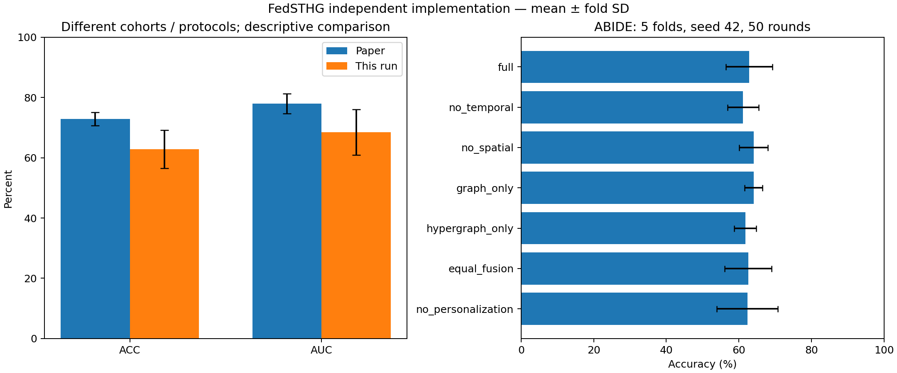

# FedSTHG 实验与复现评估

本报告由 `python make_report.py` 从实际运行记录生成。完成了独立公式实现、测试、ABIDE 公共衍生数据的完整模型与六项消融；**尚未完成论文原始协议及四数据集的严格结果复现**。

## 1. 实际执行范围

- 真实 ABIDE：484 人、4 个客户端，种子 42，5 折，每折 50 轮。完整模型及六个变体共 35 次折训练、1750 轮通信。
- 合成数据：60 人、2 个虚拟客户端；完整模型和六项消融各 5 折、每折 5 轮。这些数据只验证软件功能，不是疾病诊断证据。
- 另有 ABIDE 单折单轮 smoke 实验，不计入下面的主结果。
- 测试集仅在第 50 轮评价；未按测试指标挑选轮次或修改超参数。验证集日志、划分、配置、软件版本、源文件哈希、逐人概率和最终检查点均保留。

## 2. ABIDE 主结果

单位为百分数，± 为五折样本标准差（ddof=1），不是置信区间。实测为每折汇集四客户端测试预测的 pooled 指标。论文汇总细节不完整，队列和预处理也不同，因此这里只作描述性对照，不能解释为同条件算法优劣。

| 指标 | 论文 | 实测 | 实测−论文（百分点） |
|---|---:|---:|---:|
| ACC | 72.81 ± 2.22 | 62.82 ± 6.38 | -9.99 |
| AUC | 77.93 ± 3.25 | 68.45 ± 7.61 | -9.48 |
| SEN | 70.89 ± 2.70 | 55.30 ± 21.97 | -15.59 |
| SPE | 72.96 ± 4.50 | 70.47 ± 17.05 | -2.49 |
| F1 | 71.04 ± 2.42 | 57.42 ± 14.91 | -13.62 |

各折结果：

| 折 | 测试人数 | ACC | AUC |
|---|---:|---:|---:|
| 0 | 98 | 56.12 | 61.54 |
| 1 | 97 | 73.20 | 80.89 |
| 2 | 97 | 60.82 | 63.80 |
| 3 | 96 | 60.42 | 69.88 |
| 4 | 96 | 63.54 | 66.15 |

客户端等权宏平均 ACC 为 62.50 ± 5.85，AUC 为 69.80 ± 9.81。完整五指标、混淆矩阵及每站点结果见各折 metrics.json；不把 pooled 与 macro 混用。

## 3. 真实数据消融

所有变体沿用相同的受试者划分、种子、轮数及数据缓存。删除路径后参数量变化，未人为补足容量；相同种子也不意味着不同结构具有完全相同的随机数消耗。未进行多种子显著性检验。

| 变体 | 论文 ACC | 实测 ACC | 论文 AUC | 实测 AUC |
|---|---:|---:|---:|---:|
| 完整模型 | 72.81 ± 2.22 | 62.82 ± 6.38 | 77.93 ± 3.25 | 68.45 ± 7.61 |
| 去时间分支 | 70.33 ± 2.84 | 61.17 ± 4.31 | 72.61 ± 3.70 | 63.37 ± 6.02 |
| 去空间分支 | 69.56 ± 3.41 | 64.05 ± 3.95 | 71.10 ± 2.08 | 66.27 ± 6.87 |
| 仅图 | 69.18 ± 1.21 | 64.06 ± 2.50 | 72.10 ± 1.35 | 67.43 ± 3.19 |
| 仅超图 | 69.18 ± 2.08 | 61.78 ± 3.04 | 72.27 ± 4.04 | 67.00 ± 5.78 |
| 等权融合 | 69.94 ± 2.30 | 62.59 ± 6.46 | 74.00 ± 2.78 | 66.53 ± 7.97 |
| 去个性化 | 71.08 ± 3.04 | 62.36 ± 8.39 | 73.21 ± 3.15 | 71.65 ± 6.16 |

本次 去空间分支、仅图 的平均 ACC 高于完整模型，未重现论文“完整模型最好”的排序。折间波动较大，不能仅凭均值判断模块有益或无益；本报告不根据这些测试结果重新调参。

去个性化消融使用共享编码器与共享分类头、仅执行阶段 I；这是对该消融的显式实现假设，不是将完整 FedSTHG 替换为 FedAvg。其他未明确的消融细节见 research.md 的 B11。

## 4. 验证证据

- `results/tests.txt` / `tests.xml`：37 项测试通过，覆盖 FC、邻域、GIN/HGIN 解析公式、四路梯度、融合、B=1、参数隔离、近端参考、加权聚合、划分、保存恢复与小规模训练。
- `docs/cohort_audit.json`：484 个 ROI 文件的列顺序一致；sFC/dFC 全部有限、对称、零对角线。5 人存在恒定 ROI，相关值按显式数值规则处理并记录，未为贴合论文人数强行筛选。
- `results/*/audit.json`：独立从 CSV 重算指标，检查测试 ID、标签、站点、完整五折、检查点轮数与原始 manifest 哈希；带 cache 的审计另从检查点重算逐人预测。
- 主实验与六项真实消融共35个检查点的逐人概率精确重现，最大绝对差为 0.0；CPU 断点续训（含 dropout）测试验证恢复 RNG 后与不中断运行一致。
- GPU 上实际完成全尺寸 batch16 前向、反向和训练；主实验首折峰值已分配显存约 178.6 MiB。该数值是 PyTorch allocated memory，不是整个进程/驱动的显存占用。

## 5. 差异排查与解释边界

| 排查项 | 已查事实 | 仍未解决的影响 |
|---|---|---|
| 数据来源与名单 | 官方 PCP cpac/filt_global/AAL116，484 人；论文529人 | 作者名单、QC排除及缺失衍生物不明 |
| 预处理 | 从现有 ROI 开始；对齐/归一化/Pearson/Fisher/滑窗已实现 | 未从原始 NIfTI 重建论文完整影像管线 |
| 结构 | 四路并行与 HGIN 均按公式；局部参数不上传 | 当前推理630,348参数，论文约1.914M，容量明显不一致 |
| 超参数 | 已用论文明确的维度、层数、邻域、lr、wd、μ、λ及50轮 | 窗长30/步长2、适配器/分类头等为显式假设 |
| 优化 | 临时共享与持久个人编码器分离；阶段II参考固定 | Adam状态跨阶段是否保留未公开，本实现每次本地优化重置 |
| 随机性与统计 | 固定seed42、逐折初始化42+fold、确定性设置、折SD | 未取得作者种子；未做5种子×5折统计及BH-FDR |
| 环境 | Python3.13.9、torch2.9.1+cu128、RTX5070 Laptop | 与论文Python3.11/A6000不同；跨平台不保证逐位相同 |
| 汇总方式 | pooled和macro均保留；正类患者，阈值0.5 | 原文汇总细节与SD定义需作者确认 |

这些差异是结果差距的候选解释，尚无控制实验能够把差距归因到单一因素。尤其参数量差异尚未解决，不能将核心公式通过测试等同于作者架构完全一致。

## 6. 合成验证（不可与论文诊断指标对照）

| 变体 | ACC | AUC |
|---|---:|---:|
| 完整模型 | 80.00 ± 17.28 | 96.11 ± 5.41 |
| 去时间分支 | 80.00 ± 17.28 | 99.44 ± 1.24 |
| 去空间分支 | 75.00 ± 16.67 | 95.00 ± 5.69 |
| 仅图 | 70.00 ± 18.26 | 77.22 ± 19.78 |
| 仅超图 | 71.67 ± 20.07 | 77.22 ± 21.55 |
| 等权融合 | 90.00 ± 9.13 | 97.22 ± 4.81 |
| 去个性化 | 86.67 ± 15.14 | 100.00 ± 0.00 |

## 7. 可行性结论与未完成项

现有8GB GPU足以运行本实现的116 ROI、batch16及四客户端顺序模拟。实测证明本次工程可运行，不证明作者完整网络或原始影像预处理的资源需求相同。

| 数据集 | 实际训练 | 状态 |
|---|---|---|
| ABIDE | 完整模型及六消融，5折×50轮 | 公共ROI协议，未达论文原始结果 |
| ADHD-200 | 未运行 | 官方Athena AAL训练/测试下载链接当前跳转登录；管线GSR也待核实 |
| REST-meta-MDD | 未运行 | 官方要求数据使用协议及申请密码/表型，未代用户申请 |
| 私有失眠ID | 未运行 | 未发现可合法直接下载的队列，不使用虚构患者替代 |

方法层面已覆盖论文全部核心计算与两阶段参数流；原始影像预处理、作者精确网络配置、官方划分和四数据集结果尚未复现。不计算没有明确分母的“复现百分比”。

优先后续工作：取得作者代码/补充材料与受试者名单，核实参数量差异；重建匹配的预处理和公开数据接入；在预先冻结配置后完成多种子实验。其后再补13种外部基线、统计检验、解释性及隐私压力实验。本交付是单机联邦模拟，没有跨机构部署、安全聚合或差分隐私机制。

资源检索、公式—实现—验证对应与A/B/C假设见 [research.md](research.md)；下载和访问证据保存在同目录 JSON；学习说明见 [learning_guide.md](learning_guide.md)。

