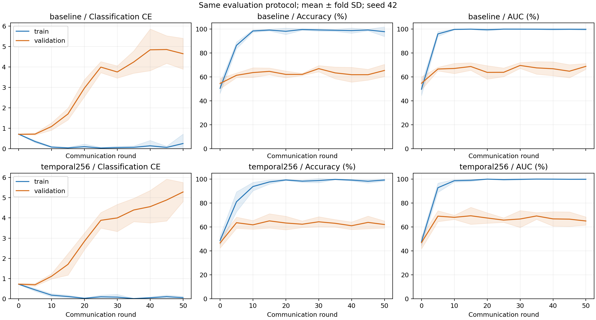

# 两层时间投影对照与学习曲线诊断

原始成果已上传 GitHub main（e6d0ad4）。本报告对应独立实验分支；新版本是结构假设，不是已确认的作者网络。实验方案先于训练写定，见 [projection_protocol.md](projection_protocol.md)。

两组均使用484名ABIDE受试者、同一客户端内五折、seed42、50轮、原有训练配置。唯一结构变量为时间输入投影。每5轮在eval模式下分别计算训练/验证指标，测试只在最终轮评估。这里的±是五折样本标准差，不是五次独立种子实验或置信区间。

## 1. 结构与验收

| 项目 | 原始单层 | 两层256 |
|---|---:|---:|
| 时间投影 | 6670→64→ReLU→LN | 6670→256→ReLU→64→LN |
| 推理参数 | 630,348 | 1,927,628 |
| 共享编码器参数 | 588,554 | 1,885,834 |

- 41项测试通过：原有37项加投影、诊断、损失和保存加载测试。
- 插入诊断后的五折基线逐人预测与历史结果完全相同；诊断没有改变该次训练结果。
- 两组共10个最终检查点经独立审计重算预测，详见 verification.json 和各组 audit.json。
- 当前两层结构接近论文的参数分布及时间分支35个参数张量，但总参数仍不是论文1.914M；本地模块、时间窗口等假设仍未解决。

## 2. 固定第50轮的训练与验证表现

| 模型 | 训练ACC % | 验证ACC % | 训练AUC % | 验证AUC % | 训练CE | 验证CE |
|---|---:|---:|---:|---:|---:|---:|
| baseline | 97.73 ± 4.02 | 65.32 ± 5.11 | 99.68 ± 0.60 | 68.74 ± 2.40 | 0.25 ± 0.46 | 4.65 ± 0.76 |
| temporal256 | 99.22 ± 0.91 | 62.03 ± 2.97 | 99.86 ± 0.31 | 64.98 ± 3.40 | 0.05 ± 0.06 | 5.28 ± 0.47 |

按预先指定的第50轮平均验证AUC，选择 **baseline**。该选择只是在本次两候选中比较，不代表已证明跨队列稳定优越。

## 3. 固定最终轮测试（不用于选择）

| 指标 | 原始单层 | 两层256 | 两层−单层（百分点） |
|---|---:|---:|---:|
| ACC | 62.82 ± 6.38 | 65.10 ± 4.63 | +2.28 |
| AUC | 68.45 ± 7.61 | 66.92 ± 8.38 | -1.53 |
| SEN | 55.30 ± 21.97 | 67.08 ± 12.60 | +11.78 |
| SPE | 70.47 ± 17.05 | 62.86 ± 21.52 | -7.61 |
| F1 | 57.42 ± 14.91 | 65.51 ± 2.20 | +8.09 |

逐折记录：

| 折 | 单层验证AUC % | 两层验证AUC % | 单层测试AUC % | 两层测试AUC % |
|---|---:|---:|---:|---:|
| 0 | 67.02 | 59.81 | 61.54 | 54.42 |
| 1 | 71.99 | 66.51 | 80.89 | 75.72 |
| 2 | 66.38 | 69.10 | 63.80 | 73.15 |
| 3 | 67.82 | 65.00 | 69.88 | 67.23 |
| 4 | 70.48 | 64.49 | 66.15 | 64.07 |

## 4. 曲线与站点诊断

分类CE直接从logits计算，未混入近端惩罚或一致性损失；训练与验证都关闭dropout，分别在各自数据内以固定顺序构图。曲线阴影为五折标准差。

- baseline：第50轮训练CE 0.2493，验证CE 4.6519；初始验证CE 0.7017；训练−验证ACC差 32.42 个百分点。
- temporal256：第50轮训练CE 0.0516，验证CE 5.2835；初始验证CE 0.7232；训练−验证ACC差 37.19 个百分点。

训练很好而验证较差是泛化差距的证据；若验证CE上升同时AUC保持相近，还可能是错误预测更自信，不等于所有排序能力都下降。该实验不能把差距唯一归因为过拟合或站点偏移。

| 站点 | 单层验证ACC % | 两层验证ACC % | 单层时间门控均值 | 两层时间门控均值 |
|---|---:|---:|---:|---:|
| NYU | 73.57 | 62.86 | 0.999955 | 0.999956 |
| UCLA | 53.75 | 60.00 | 0.999959 | 0.999961 |
| UM | 62.61 | 60.87 | 0.999960 | 0.999965 |
| USM | 66.67 | 65.00 | 0.999954 | 0.999954 |

两组各折各站点最终验证集的平均时间门控范围为 0.999909–0.999990，融合权重高度偏向时间分支。空间路径仍参与一致性损失和门控计算，不能据此断言完全没有作用。后续应优先追踪门控饱和、两分支特征尺度及梯度，再判断是否需要调整；不能把强制等权或新增约束伪装成论文原始方法。

## 5. 成本与结论边界

| 模型 | 平均每折耗时秒（含诊断/保存） | 峰值PyTorch allocated MiB |
|---|---:|---:|
| baseline | 55.0 | 179.7 |
| temporal256 | 58.7 | 256.3 |

本次只有一个基础种子、五折，且之前已看过基线测试结果，因此属于探索性比较，不能宣称统计显著、临床有效或完整复现论文。更多参数不自动代表更好。后续应先依据验证结果确定是否保留两层投影，再冻结多种子确认方案；若泛化差距明显，优先研究正则化/学习率/个性化约束，不继续盲目扩容。

原始数据与划分差异未改变；参数增大也改变初始化随机数消耗及近端惩罚的参数集合。本次保持论文μ不变，未把近端项改成均方，否则会成为另一项算法改动。候选投影的变化包含层数、宽度和ReLU位置，不能把观测差异单独归因于参数量。
